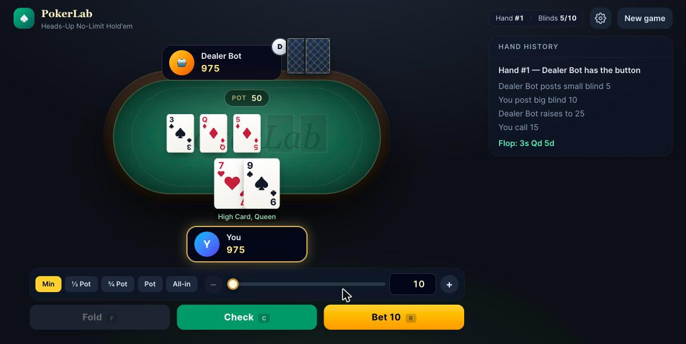

# PokerLab

**PokerLab** is a poker platform that combines interactive play, game-playing AI, probability and game theory.
The first release, **v0.1**, is a fully playable game of **heads-up No-Limit Texas Hold'em** against a computer opponent. It runs on a rules-accurate Python engine behind a React interface.

> Virtual chips only. PokerLab does not involve real-money gambling.



## Features (v0.1)

**Game engine**
- Standard 52-card deck with seeded Fisher–Yates shuffling. Cards are dealt one at a time from the left of the button, with burn cards.
- Full No-Limit betting: fold, check, call, bet, raise and all-in.
- Correct heads-up positions: the button posts the small blind and acts first preflop, then last on every later street.
- Minimum-raise rules. An all-in for less than a full raise does **not** reopen betting for players who have already acted.
- Raises are capped at what an opponent can actually call. Uncalled bets are returned.
- Main and side pots, split pots, and odd-chip distribution.
- Edge cases: short all-in blinds, all-in runouts, and automatic board runout once no further betting is possible.
- Fast 5–7 card hand evaluator (no brute-force combinations), cross-checked against brute force in the tests.
- Each hand emits an event stream (blinds, actions, streets, reveal, showdown, awards), which the UI animates.

**Computer opponent**
- Rule-based agent: Chen-formula preflop strength, a made-hand and draw heuristic postflop, pot odds, value bets, occasional slow-plays and bluffs.
- Every decision passes through a legality guard. The tests play thousands of hands to confirm the agent never makes an illegal move.

**Interface**
- Felt table with animated dealing, card flips, chip stacks, a dealer button, action bubbles and a turn indicator. The opponent shows a "thinking" pause before it acts.
- Betting controls: pot-fraction presets, slider, numeric input, ± big-blind nudges, and keyboard shortcuts (`F` / `C` / `R`, `Space` for the next hand).
- Live hand history, your current made hand ("Two Pair, Aces and Fours"), showdown reveals and winner banners.
- Automatic progression to the next hand with a countdown. You can turn it off and choose an animation speed.
- Game-over screen when a player busts, plus restart and new-game setup (name, stack depth, blinds).
- Responsive layout from phone to desktop, in a dark theme.

**v0.2.1 — Visual redesign**
- Redesigned cards with vector suit glyphs (no emoji or font substitution), framed court cards and a bordered card back.
- Casino-style chips with edge inserts, stacked in columns for larger pots.
- Seats rebuilt as nameplates over fanned hole cards. The action tag and made hand sit in a tag row under each nameplate.
- Textured felt with a betting line, a brass rail inlay, and a portrait-friendly table shape on phones.
- Hand history shows board and shown cards as mini cards.
- Bundled Inter and Playfair Display fonts, a unified dark surface system, and a reworked betting dock.

**v0.2.2 — Animations and interactions**
- Cards are dealt one at a time from a deck on the felt. Your cards land face down and turn over, and the flop lands face down before turning left to right.
- Chips fly from stacks to bets, from bets into the pot, back to the owner when a bet is uncalled, and from the pot to the winner. Stack counts roll to their new value.
- Each action has its own feedback: check, call, bet/raise, all-in and fold.
- At showdown the opponent's cards flip, the five cards that make the winning hand light up, and the rest are muted.
- Cards are collected between hands, and stale action tags clear when a betting round ends.
- Animation speed follows the speed setting. Instant speed and the OS "reduce motion" preference skip movement.

**v0.2.3 — Sound effects and customization**
- Subtle sounds for dealing, card turns, chips, checks, bets and raises, all-ins, folds, collecting bets and pushing the pot. Each sound is timed to its animation.
- Every sound is synthesised in the browser with the Web Audio API, so there are no audio files or licences involved. Small random variations and rate limits keep repeats from sounding mechanical or piling up.
- Audio starts only after your first click, tap or key press, as browsers require.
- Mute button in the header, plus a volume slider (with a preview sample) in the settings menu.
- Three table themes: classic green, midnight blue and burgundy.
- Sound, volume, theme, animation speed and auto-deal are saved in the browser and survive a refresh. Invalid saved values fall back to the defaults.

**v0.2.4 — Stability, accessibility and UX**
- Keyboard shortcuts no longer fire while you type in a field or while a dialog is open, and auto-deal waits while a dialog covers the table.
- If a request fails, the table re-syncs with the server. A lost game (for example after a server restart) offers a new game, and an unreachable server offers Retry.
- API hardening: per-session locking, client seeds disabled by default (`POKERLAB_ALLOW_SEED`), idle games expire, and finished games are evicted before live ones.
- The whole game can be played from the keyboard. Dialogs trap and restore focus, focus returns to the betting controls each turn, and every control shows a visible focus ring.
- Screen readers: your turn and options are announced, and cards in the hand history, stacks, bets and the dealer button all have text.
- Touch: larger tap targets on phones, no zoom when tapping inputs or tapping buttons quickly, and higher-contrast small text.

**v0.3.1 — Equity engine**
- All-in equity for 2+ players from known hands, **ranges** (`QQ+, AKs, T9s-65s, A5s-A2s, any`), any partial board, and dead cards. Split pots give each tied player an equal share, and results report win, tie and equity separately.
- **Exact enumeration** when the deal space is small (for example any flop or turn with known hands). Otherwise **seeded Monte Carlo**, which reports a standard error, a 95% interval and the seed that reproduces the run.
- Card removal is handled jointly. When ranges compete for the same cards, the whole deal is redrawn rather than drawing players one at a time, which keeps the estimate unbiased. A test shows that one-at-a-time drawing would miss by about 13 percentage points.
- A table-driven 5–7 card scorer, about 15× faster than the reference evaluator (≈1 µs per 7-card hand). It is checked against the reference evaluator and against the textbook counts for all 2,598,960 five-card hands (7,462 distinct hand values).
- Validated: exact results match an independent brute-force implementation. AhAs vs KhKs enumerates to the published 82.36% win, and AA vs a random hand gives about 85.2%.
- Command line: `python -m pokerlab.equity AhKh "QQ+,AKs" --board Qs7d2c`.

**v0.3.2 — Equity-driven opponent and equity review**
- New default opponent. On every decision it estimates your range from your actions, computes its equity against that range (exact or Monte Carlo), and compares it with the pot odds. Facing an all-in, it calls exactly when that is +EV against the estimated range. Unopened preflop pots use a precomputed ranking of all 169 starting hands.
- Opponent range model: preflop actions cap the range at "top X%" of hands, and postflop bets, raises and calls keep the stronger part of it while flush and open-ended straight draws stay in. The model is simple and explained in the code.
- Measured with a duplicate-deal match harness (every deal played twice with seats swapped, which cancels most card luck). Over 6,000 hands it beats the v0.1 opponent by **+32.5 ± 9.2 big blinds per 100 hands** (z = 3.5) and a random player by +323 ± 32. A decision takes about 14 ms (95th percentile 20 ms).
- **Equity review** after every showdown: both hands' equity before the flop, on the flop and on the turn. The preflop figure is a Monte Carlo estimate labelled with its 95% margin. Flop and turn figures are exact. Percentages never round a live chance to "0%" or "100%".
- `POST /api/equity` exposes the equity engine (2–6 players, hands or ranges, board, dead cards, optional seed), with limits that cap the work per request.

**v0.3.3 — Opponent difficulty levels**
- Choose **Beginner**, **Intermediate** or **Advanced** when starting a game. The header shows the current opponent. Each level changes *what the bot reasons about*, not just how random it is:
  - **Beginner** plays its own cards. It computes equity against any two cards instead of your likely range, so it overrates top pair, pays off big bets, chases draws at slightly bad prices, limps a lot and rarely bluffs.
  - **Intermediate** is the v0.3.2 opponent: it estimates your range from your actions and weighs its equity against the pot odds.
  - **Advanced** picks postflop bets by **expected value**. For each bet size it assumes you defend at the minimum defence frequency with the strongest part of your range, then bets only when that beats checking. It also reads checks as capping your range and needs less equity to call in position than out of position. It is a stronger heuristic, **not** a game-theory-optimal strategy.
- Measured with duplicate matches on seeds not used for tuning. Intermediate beats Beginner by +210 ± 20 bb/100 and Advanced beats Beginner by +452 ± 41. Advanced beats Intermediate by +28 ± 8.5 bb/100 over 7,000 hands (z ≈ 3.3, pooled over two runs; a single 3,000-hand run alone was +20 ± 12). Reproduce with `python -m pokerlab.ai.match advanced intermediate --deals 2000 --jobs 4`.
- Every level sees only public information. A test confirms that changing your hidden cards never changes the bot's decision.
- **Live all-in equity:** when both hands are turned up for an all-in, the equity panel updates street by street during the runout. Each new figure waits until its cards have turned over, and the post-hand review shows the same numbers.
- Equity panel fixes found in browser testing: the live view no longer reveals a flop or turn before it turns over, no longer flickers away on the river, and no longer appears at ordinary showdowns (where the post-hand review takes over).
- Faster ranges: `HandRange` sorts its combos once, with an integer key, instead of comparing cards in Python on every iteration.

**v0.3.4 — Adaptive opponent**
- Intermediate and Advanced now learn from how you play. They track nine statistics from the public betting only (never your cards, not even cards shown at showdown): VPIP, preflop raise, fold to a preflop raise, aggression, bet when checked to, raise against a bet, fold to a bet, went to showdown and won at showdown.
- **No overreacting.** Each statistic is a Beta-posterior estimate pulled towards a baseline (12 pseudo-hands of prior), is ignored until it has 15 opportunities, ignores deviations under 3 points, and forgets old hands (about a 150-hand memory) so it follows a player who changes style. Every adjustment is clamped.
- **What changes.** How often you bet when checked to, and how often you raise a bet, widen or narrow the range the bot assumes behind your bets and raises (frequent bettors get called lighter, rare bettors get more credit). Your preflop raise and VPIP rates rescale your preflop ranges. Your fold-to-bet rate sets how wide a range it assumes you call with, and against a player who rarely folds it bluffs less and bets thinner for value. Folding to preflop raises often makes it open more hands from the button.
- **Levels.** Beginner never adapts (your stats are still shown). Intermediate adapts at half strength, Advanced at full strength. Adaptation can be switched off on the start screen.
- **Explained.** A **Your tendencies** panel shows each stat against its reference, with sample sizes and a "needs 15" marker until it counts. It also lists the opponent's current adjustments and, after each hand, which of its decisions adaptation changed and why (worked out by re-running the decision without adaptation from the same random state).
- **Validated with controlled matches.** Adaptive and non-adaptive Advanced play their own copies of each opponent on identical cards, and the paired difference cancels most card luck (`python -m pokerlab.ai.experiments advanced --deals 2000 --jobs 8`). Results on seeds not used for tuning, 2,000 deals × 2 seats each, in bb/100:

  | Opponent (fixed style) | Adaptive | Non-adaptive | Difference |
  | --- | --- | --- | --- |
  | Aggressive (bets and raises too much) | +345 ± 47 | +79 ± 41 | **+266 ± 49** (z = 5.4) |
  | Passive (calling station) | +445 ± 33 | +355 ± 31 | **+90 ± 23** (z = 3.9) |
  | Folder (folds to most bets) | +52 ± 9 | +58 ± 11 | −6 ± 10 (no clear effect) |
  | Intermediate, non-adaptive (balanced) | +23 ± 14 | +15 ± 14 | +8 ± 15 (no clear effect) |
  | v0.1 basic bot | +60 ± 14 | +83 ± 18 | −23 ± 17 (z = −1.4, not significant) |
  | Random player | +381 ± 44 | +361 ± 45 | +21 ± 52 (no clear effect) |

  Adaptation clearly helps against the two leaky styles. Against the others the difference is within noise, and against the v0.1 bot the point estimate is negative, so it is not claimed to help there. Only Advanced was measured; Intermediate uses the same adjustments at half strength.

  Half of one adjustment was measured and removed. Bluffing more against players who fold often, and assuming they fold more to bets, cost 66 ± 17 bb/100 against the v0.1 bot and gained nothing even against the "folder" style. The other half stays: against a player who rarely folds, the bot bluffs less, bets thinner for value and expects fewer folds. Removing that half dropped the gain against the calling station from about +140 to +51 bb/100.

**v0.3.5 — Coaching and decision feedback**
- A **Coach** panel reviews every hand once it is over. Each of your decisions is graded *Good*, *Close call*, *Questionable* or *Likely mistake* (or *Not graded* when it cannot be estimated reliably), with a plain explanation, the key numbers (your equity, the equity you needed, the size of the opponent's estimated range) and every alternative side by side with its estimated EV in big blinds. "Show the maths" adds the equity source, the EV formulas, how the range was estimated, and the assumptions behind them.
- **Decision quality is kept apart from the result.** The verdict says "You won 300 chips, but 2 decisions gave up value" or "You lost 120 chips, but your decisions held up". Grades never change with the cards that came later.
- **No hindsight.** A decision is recorded with exactly what you could see when you made it: your cards, the board so far and the public betting. The opponent's cards are never an input, not even after a showdown, and a test confirms that changing them changes nothing in the review.
- **How decisions are judged.** The opponent's range is estimated from their actions with the same model the bots use, adjusted for their observed tendencies once there are enough hands (the coach tracks the bot just as the bot tracks you). Equity against that range is exact when the deal space is small, otherwise seeded Monte Carlo. Each option's EV is measured from the moment of the decision: calling is `equity × (pot + call) − call`; checking is `equity × pot`; bets and raises assume the opponent continues with the strongest part of their range at the minimum-defence frequency, and never assume more folds than against a pot-sized bet.
- **Honest limits.** These are one-street estimates, not solver output, and nothing is ever called optimal. Every grade carries a confidence level. Only pot-odds comparisons (call or fold) can be labelled *likely mistakes*. A verdict that rests on an assumed fold rate is at most *questionable*, and needs twice the margin. Bets larger than 1.5× the pot are not modelled and are left ungraded. Preflop re-raises and unopened preflop pots use clearly labelled guidelines instead of invented EVs.
- **Recurring leaks and progress.** Flagged decisions are tagged (calling without enough equity, folding when the price was right, checking strong hands, betting when behind, costly bet sizes, too loose or too tight preflop). The panel shows the leaks that keep recurring and compares your last 20 decisions with the 20 before. Progress is kept in the browser, so it carries across games and server restarts.

**v0.3.6 — Interactive training mode**
- A **Train** tab next to Play. Each scenario is a heads-up decision point with the board, the betting so far, pot, stacks and position. You pick one of the legal choices, and the feedback comes straight away: whether it was good, the numbers, and every alternative compared with its estimated EV, grade and explanation.
- **Six concepts** (seven since v0.3.7, with semi-bluffing): pot odds, drawing hands, value betting, bet sizing, preflop defence, and opponent tendencies. In tendency scenarios the opponent's stats are shown, and the spot is chosen so that those tendencies change the right answer.
- **Three difficulties.** Beginner gets clear-cut spots (the best choice wins by at least 20% of the pot), two or three choices, and a pot-odds hint. Intermediate adds draws, raises and bet sizes with an 8% margin. Advanced uses 3% margins and opponents with tendencies.
- **Personalised practice.** "Recommended for you" picks the next concept from your recurring leaks at the table, your recent training accuracy and concepts you have not tried, and says why it chose it.
- **Progress by skill:** first-try accuracy per concept (a good answer scores 1, a close one ½), the last 10 attempts, and how many table decisions in that concept were flagged.
- **Retry and compare.** "Try again" lets you take another answer on the same scenario (only the first counts towards progress), and the comparison shows how every choice would have scored.
- **Connected to real hands.** "Practise this spot" on any reviewed decision opens it as a training scenario.
- **How scenarios are made.** Cards are dealt at random and a betting line is played through the real engine, so every option is legal. The spot is analysed with the coaching engine and kept only if it teaches the concept at that difficulty; otherwise new cards are dealt. Scenario ids encode difficulty, concept and seed, so a scenario and its verdicts can be reproduced exactly and answers need no server state. There is no opponent hand in a scenario at all, and nothing about the answer is sent before you choose.

**v0.3.7 — Personalised learning and skill assessment**
- A **Progress** tab, next to Play and Train, with a single clear **Next practice** recommendation and its reason, plus estimated skill per concept, the trend of your first answers, recurring mistakes explained, the review schedule and your practice history. Progress can be exported as JSON or reset (after a confirmation).
- **Measured vs estimated.** Each concept shows plain counts (your first answers, and graded table decisions) next to an *estimated skill*. The estimate is a small Bayesian model: the chance of a good answer is `logistic(skill − difficulty)`, with difficulty −1 / 0 / +1 for Beginner / Intermediate / Advanced, a close answer counted as half, a Normal(0, 1.2²) prior, and the posterior's 80% range shown. Table decisions count at half weight, and only when the coach rated its confidence medium or high. No estimate is shown below 5 answers' worth of evidence. The dashboard says plainly that this measures agreement with PokerLab's one-street analysis, not real-money results, and that nothing is solver-verified.
- **Adaptive difficulty.** A new **Auto** level picks the difficulty per concept from the estimate. It moves up only when a pessimistic reading (the one-sided 80% lower bound) still expects a 60% score at the harder level, and back down after misses, rather than after a fixed number of hands. In practice that takes about 8 good Beginner answers in a row to reach Intermediate; 7 out of 10 stays at Beginner.
- **Spaced repetition.** A missed scenario brings its concept back as a *new* scenario (so you can't just remember the answer) after 10 minutes, then after 1, 3, 7 and 21 days with each success; a miss starts it again. Getting it right before it is due earns no credit. Confident mistakes at the table schedule a review too. Due reviews come first in "Recommended for you" and are marked **Review**.
- **Recommendations** come from due reviews first, then a weighting of recurring table leaks, low estimated skill and concepts with too little evidence, at your adaptive level.
- **Mistake explanations.** Each recurring leak links to the principle behind it, a concrete fix and your own numbers where they exist ("across 4 of these spots you had about 22% equity on average when a call needed 33%"), with a button to practise that concept.
- **Semi-bluffing**, a seventh training concept: checked to you with a draw while behind, bet or take the free card? Pure bluffs are not trained, because against a range that defends at the minimum-defence frequency they only break even, so the engine cannot say anything meaningful about them.
- **Consistent feedback.** Practising a reviewed decision now uses exactly the review's analysis (same seed, same samples, and the size you actually bet), so the training verdict always matches the review; a test checks this.
- Progress is still kept in the browser (the existing store, with new validated fields). Older saved progress loads unchanged.

**v0.4.0 — Reliable progress persistence**
- **Why a database now.** Until v0.3.7, progress lived only in the browser. That copy capped history at 600 decisions and 1,000 answers, dropped unreadable records without a word, swallowed "storage full" errors, was lost with cleared site data or a private window, and two open tabs could overwrite each other's new answers. Every PokerLab feature already needs the Python server, so a database there adds no new service to run. SQLite ships with Python, so there is also no new dependency.
- **Local first, server backed.** Progress is saved in the browser at once, so the app keeps working when the server is down, and synced to a SQLite database on the server in the background. The Progress tab shows where your progress is saved and whether it is synced; when the server is unreachable or its storage is down, records wait on the device and sync automatically, with retries backing off, once it is back.
- **No conflicts by design.** Progress is an append-only log of immutable records (graded decisions and first answers), each with a unique id. A sync is a union in both directions, and an upload that is repeated, interrupted or sent from two devices at once cannot lose or duplicate anything. Skill estimates, the review schedule, trends and leaks are all derived from that one log, so the coach, training and the dashboard always agree. The review schedule is recomputed rather than stored, so it can never drift from the history.
- **Profiles without accounts.** Each profile gets a random 256-bit key, shown on request for opening the same progress in another browser on the same server. The server stores only the key's SHA-256 hash, so the database file alone cannot be used to read or write a profile. Several players can keep separate profiles on one device and switch between them.
- **Validation everywhere.** Records are checked field by field on the device and again on the server (concept, grade, level, tags, finite numbers, timestamps in milliseconds, no unknown fields). One bad record never blocks the rest of an upload: the server stores the valid ones and returns the reasons for the others, which stay on the device marked as refused.
- **Nothing is deleted silently.** Records that fail validation, and unreadable saved data, are moved to a quarantine, reported on the Progress tab, and included in exports. A full or blocked browser store is reported instead of ignored. Local history is trimmed only beyond 20,000 records per kind, and never records that have not reached the server yet.
- **Safe migration.** On first start, v0.3.x progress is copied to a backup key, migrated (old decisions get stable ids) and queued for upload. The old copy is removed only once the new one has been written, and the migration says what it moved and what it kept aside.
- **Durable and recoverable server storage.** SQLite runs with WAL journaling and full synchronous writes, and each upload is a single transaction (all or nothing). If the database file is corrupt, unreadable or from a newer version, the server keeps serving games, reports progress storage as unavailable (`503`) and leaves the file untouched for recovery, rather than replacing it.
- **Two-tab safety.** Every save reads what is stored and merges it, so two tabs never erase each other's records. Tabs also pick up each other's changes live. A reset starts a new "epoch" so another tab cannot bring the deleted records back.
- **Failures mid-session.** A database error after startup (disk full, I/O error, a lock held too long) returns `503` like storage that never opened, so clients keep the records and retry. A sync that is in flight when the profile is reset (in this tab or another) is discarded rather than merged, so it cannot bring deleted records back.
- **Export, import and reset.** Export writes a JSON file (including any unreadable records); import merges a file from v0.3.x or v0.4 after validating it. Reset deletes the profile's progress on the device and on the server, and refuses to delete anything locally if the server copy cannot be deleted at that moment.

## Quick start

Requirements: **Python 3.11+** and **Node.js 20.19+** (CI uses Node 24).

```bash
make install   # creates backend/.venv and installs frontend packages
make dev       # API on :8000 and UI on :5173
```

Then open <http://localhost:5173>.

<details>
<summary>Without make</summary>

```bash
# backend
cd backend
python3 -m venv .venv
.venv/bin/pip install -e ".[dev]"
.venv/bin/python -m pokerlab          # http://127.0.0.1:8000

# frontend (second terminal)
cd frontend
npm install
npm run dev                            # http://localhost:5173 (proxies /api to :8000)
```
</details>

Configuration is optional. See [`.env.example`](.env.example). Progress is stored in `backend/data/pokerlab.sqlite3` by default (`POKERLAB_DATA_DIR` or `POKERLAB_DB` to change it); back it up by copying the file while the server is stopped. Deleting it removes every profile, and the browsers that still hold progress offer to save it again.

## Testing

```bash
make test      # pytest + vitest
make lint      # ruff + TypeScript
```

- **Backend (pytest, 330+ tests):** progress storage (survives restarts, only key hashes stored, idempotent unions, an interrupted batch writes nothing, profile isolation, quotas, corrupt or newer databases left untouched and reported, per-record validation over HTTP, games unaffected when storage is down), training (semi-bluff scenarios, practice verdicts identical to the review's, every concept generated at its difficulty margin, deterministic ids, no verdicts before answering, tendencies that change the answer, practice spots), coaching (grades against exact pot-odds cases, the documented EV formulas, the capped fold model, no optimality claims, reviews unchanged by the opponent's hidden cards and by the run-out, reproducible analyses, fuzzed random spots), deck and evaluator correctness (including exhaustive five-card frequencies), opponent modelling (statistics from public events only, shrinkage and minimum samples, decay, bounded adjustments, decisions unchanged by the human's hidden cards, legal play against every style, paired comparisons), difficulty levels (decisions that differ for stated reasons, decisions independent of the human's hidden cards, legality at every level, stronger levels beating Beginner, the expected-value formula), live all-in equity, the equity agent (exact pot-odds boundaries, legality, range estimates, a duplicate match against a random player), equity (exact results against an independent brute force, Monte Carlo accuracy within its standard error, overlapping ranges, reproducible seeds), range parsing, betting rules, illegal actions, side pots and odd chips, short-stack edge cases, AI legality, sessions, API robustness (locking, seeds, eviction), and full games played over HTTP. Randomized fuzz tests play thousands of 2–6 player hands and check chip conservation after every action.
- **Frontend (Vitest + Testing Library):** progress storage and sync (v0.3 migration with backup, migration that cannot be written, quarantine of unreadable data, two tabs merging, reset epochs, trimming that keeps unsynced records, storage-full reporting, linking, offline queueing, pulling from another device, refused records, resuming an interrupted upload, unknown keys, import and export), personalised learning (the skill model's posterior and intervals, promotion only on solid evidence, spaced-repetition scheduling and graduation, recommendations, mistake guides, the dashboard, persistence across reloads), training (feedback, retries not counted, difficulty and concept requests, table shortcuts blocked while training), the coach panel and the progress store (recommendations, leaks, trends, malformed storage), difficulty selection and the adaptation toggle, the tendencies panel, the equity panel (live and review modes, reveal timing, percentage formatting), betting controls, seats and hidden cards, sizing helpers, animations, accessibility (focus, dialogs, announcements), connection failures and keyboard shortcuts, the sound engine (against a fake AudioContext) and event-to-sound timing, saved settings, and app flows with a mocked API (deal → act → showdown → next hand, errors, game over).
- **CI:** GitHub Actions runs lint, tests and a production build on every push and pull request (Python 3.11–3.13).

## Architecture

```
backend/pokerlab/
├── cards.py          Card, Rank, Suit, Deck            ← shared by every variant
├── evaluator.py      5–7 card hand ranking (reference) ← shared by every variant
├── fasteval.py       table-driven integer hand scores  ← hot loops (equity)
├── ranges.py         starting-hand range notation      ← hold'em
├── equity.py         exact / Monte Carlo all-in equity, CLI
├── engine/
│   ├── actions.py    Action, LegalActions, errors      ← generic betting vocabulary
│   ├── pots.py       side-pot layering, pot splitting  ← generic
│   └── holdem.py     HoldemHand state machine + events ← variant-specific
├── ai/
│   ├── base.py       Agent interface, Observation (no hidden info), legality guard
│   ├── strength.py   preflop/postflop strength heuristics
│   ├── heuristic.py  basic rule-based opponent (v0.1)
│   ├── preflop.py    169 hand classes, ranking, "top X%" ranges (+ preflop_data.py)
│   ├── range_model.py  opponent range estimate from public actions
│   ├── equity_agent.py equity agent, configured by an AgentProfile
│   ├── difficulty.py Beginner / Intermediate / Advanced profiles, make_agent()
│   ├── match.py      duplicate-deal and paired agent-vs-agent evaluation (+ CLI)
│   ├── player_model.py opponent statistics (VPIP, PFR, fold to bet, ...) from public events
│   ├── adaptation.py bounded, explained adjustments from those statistics
│   ├── styles.py     fixed leaky player styles for experiments
│   ├── experiments.py adaptive vs non-adaptive controlled matches (+ CLI)
│   └── random_agent.py
├── coach/
│   ├── analysis.py   grade one decision from the player's own view: range, equity, EV per option
│   ├── review.py     post-hand reviews, decision quality vs result, opponent tendencies
│   ├── spot.py       a decision point as public data, replayed through the engine
│   └── training.py   scenario generation by concept and difficulty, grading, practice spots
├── session.py        heads-up match: hand sequencing, AI turns, per-seat views, log, coach
├── storage.py        SQLite progress store: profiles (hashed keys), append-only records, integrity checks
└── api/              FastAPI app, schemas, session store

frontend/src/
├── hooks/usePokerGame.ts   API calls + step-by-step animation playback
├── hooks/useGameSounds.ts  plays table sounds from the same event stream
├── components/             Table, Seat, PlayingCard, ChipStack, ChipFlights, ActionBar, HandLog, SettingsMenu, modals,
│                           EquityPanel, TendenciesPanel, CoachPanel, DecisionDetail, TrainingView, ProgressDashboard, SkillMeter
└── lib/                    API client, betting and card helpers, motion timing, sound engine and cues, progress store,
                            skills (skill model, adaptive level, spaced repetition, recommendations),
                            store (local persistence, migration, quarantine), sync (server sync)
```

**How a turn works.** The server holds all game state. Each request (`POST /api/sessions/{id}/actions`) applies the human's action, then lets the AI act until it is the human's turn again or the hand ends. The response contains the final state plus a list of `steps`. Each step is an engine event paired with a state snapshot taken right after it, so the UI can replay the AI's moves, new streets and showdowns one at a time. Opponent hole cards are left out of every snapshot until they are shown down.

**Extensibility.**
- New variants reuse cards, the evaluator, actions and pot logic, and add their own hand state machine.
- New AI strategies implement `Agent.decide(observation, legal_actions)`.
- `HoldemHand` already supports more than two players, ready for multi-way tables.

### API

| Method | Path | Description |
| --- | --- | --- |
| `GET` | `/api/health` | Health check, including whether progress storage is available |
| `POST` | `/api/sessions` | Create a match (`starting_stack`, `small_blind`, `big_blind`, `player_name`, `difficulty` = `beginner`\|`intermediate`\|`advanced`, `adaptive`; `seed` only when the server sets `POKERLAB_ALLOW_SEED`) |
| `GET` | `/api/sessions/{id}` | Current state (from the human's point of view) |
| `POST` | `/api/sessions/{id}/hands` | Deal the next hand |
| `POST` | `/api/sessions/{id}/actions` | `{"action": "fold"\|"check"\|"call"\|"bet"\|"raise"\|"all_in", "amount"?: raise-to total}` |
| `GET` | `/api/sessions/{id}/hands/{n}/review` | Coaching review of the latest finished hand (`404` while it is in progress) |
| `GET` | `/api/training/scenario` | `?difficulty=beginner\|intermediate\|advanced&concept=pot_odds\|draws\|value_betting\|bluffing\|bet_sizing\|preflop\|reads&seed?` → a scenario (no answers included) |
| `POST` | `/api/training/practice` | `{"spot": {...}, "difficulty"?, "chosen"?}` → a scenario from a reviewed decision |
| `POST` | `/api/training/answer` | `{"id", "choice"}` → grade, explanation and every alternative compared |
| `DELETE` | `/api/sessions/{id}` | End a match |
| `POST` | `/api/profiles` | `{"name"?}` → a new progress profile and its secret `key` (returned once) |
| `GET` / `PATCH` / `DELETE` | `/api/profile` | The profile for `Authorization: Bearer <key>`, with record counts; rename; delete it and all its records |
| `GET` | `/api/profile/records` | `?limit` → the most recent records of each kind, oldest first |
| `POST` | `/api/profile/records` | `{"answers": [...], "decisions": [...]}` (≤ 2,000 each) → added, accepted and per-record rejection reasons; repeats are no-ops |
| `POST` | `/api/equity` | `{"players": ["AhKh", "QQ+,AKs"], "board"?, "dead"?, "iterations"?, "seed"?}` → equity, win, tie and standard error per player |

Each response includes `steps`: one event plus a state snapshot for every change, which the UI replays to drive its animations. Showdown events list each player's best five cards (`best`), and `pot_awarded` events list the winning cards (`cards`).

Illegal actions return `400` with an explanation. Out-of-turn or out-of-state requests return `409`. Interactive docs are served at `/docs`.

## Roadmap

- **v0.2 — Visual polish:** v0.2.1 visual redesign, v0.2.2 animations, v0.2.3 sound and themes, and v0.2.4 stability and accessibility (done).
- **v0.3 — Smarter AI and training:** v0.3.1 equity engine, v0.3.2 equity-driven opponent with equity review, v0.3.3 difficulty levels and live all-in equity, v0.3.4 adaptive opponent, v0.3.5 coaching and decision feedback, v0.3.6 interactive training mode, v0.3.7 personalised learning and skill assessment (done).
- **v0.4 — Platform:** v0.4.0 reliable progress persistence (done); next, persistent hand history and replays.
- **v0.4 (continued) — Analytics:** persistent hand history, replays, performance stats, AI-vs-AI simulations.
- **Later:** multiplayer, tournaments, Omaha / Stud / Draw, CFR agents, reinforcement learning, strategy dashboards.

## Security and privacy

- Progress contains poker statistics and an optional profile name, nothing else. It is stored on your own PokerLab server and in your browser; nothing is sent to third parties.
- A profile key is a bearer secret: anyone with it, and access to the same server, can read and change that profile. It is kept in the browser's local storage, shown only on request, sent only in the `Authorization` header (never in URLs, so it does not appear in server logs), and stored on the server only as a SHA-256 hash.
- The API checks every record, caps request sizes and the number of records per profile, and allows browser requests only from the configured origins (`POKERLAB_CORS_ORIGINS`).
- There are no user accounts or passwords. PokerLab is meant to run on your own machine or a trusted network; exposing it to the internet would need HTTPS and rate limiting in front of it.

## License

MIT
